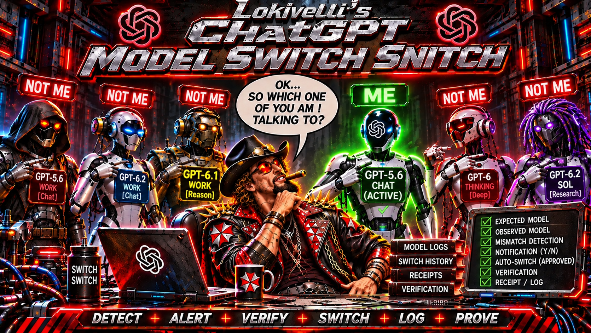

# Lokivelli's ChatGPT SwitchSnitch



Android/Termux-backed watchdog for unexpected ChatGPT model changes.

## Acceptance boundary

SwitchSnitch distinguishes:
- **selected model**: what the ChatGPT UI reports;
- **observed model**: model evidence exposed to the page/extension;
- **expected model**: the operator's lock target.

It never claims backend certainty when ChatGPT does not expose trustworthy model metadata. Unknown stays `UNVERIFIED`.

## Intended flow

1. Extension watches ChatGPT's visible model selector.
2. If selected/observed differs from expected, it POSTs an event to the Termux bridge.
3. Termux raises an Android notification with **YES — SWITCH BACK** and **NO — ACCEPT**.
4. YES queues a RESTORE decision. NO queues ACCEPT.
5. Extension polls the bridge, executes the requested UI change, verifies the visible selector, and records a receipt.
6. It never automatically resends a prior user message.

## Status

Repository baseline is implemented. **HOLD for live S24 Ultra/browser verification**: DOM selectors and Android browser extension support must be smoke-tested against the actual current ChatGPT UI.

## Install (Termux)

Requires Termux:API app/package.

```bash
git clone https://github.com/lokivelli316/Lokivellis-chatgpt-switchsnitch.git
cd Lokivellis-chatgpt-switchsnitch
bash termux/install.sh
```

After installation, start SwitchSnitch from anywhere with the one-word command:

```bash
snitch
```

Then load `extension/` as an unpacked WebExtension in a compatible Android/desktop browser. Set the expected model in the extension popup.

Default bridge: `http://127.0.0.1:8765`.

## Security

The bridge binds to loopback only. It does not expose a LAN listener. Receipts contain model state, chat title, timestamp, and decision—not prompt/response bodies.

## Tests

```bash
python -m unittest discover -s tests -v
```

## Native Android and recovery upgrade
Browser transport, retry and observer health have been repaired. The additive native Android companion is documented in [android/](android/README.md). Existing checkouts: run `git pull --ff-only origin main` then `bash termux/activate.sh`. APK test builds are published to [Releases](../../releases) by CI. The frozen specification is unchanged. Native restore requires stable chat identity and operator approval. Device acceptance and backend model identity are unverified.
